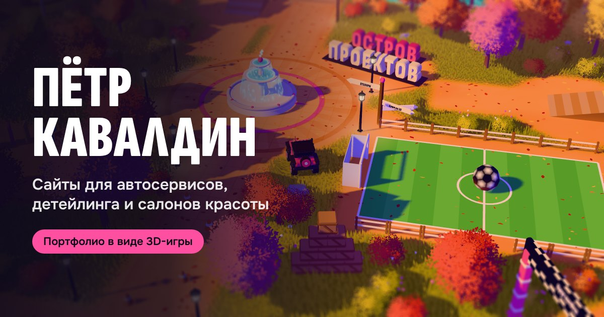

# Остров проектов

Портфолио веб-дизайнера Петра Кавалдина. Это обычный сайт и 3D-игра: по острову можно проехать на джипе и заглянуть в каждый проект.

- Сайт: https://kavaldinpetr-pixel.github.io
- Игра: https://kavaldinpetr-pixel.github.io/game.html



## Что внутри

- `index.html` — сайт-портфолио: проекты, цены и контакты. Анкета «Обсудить сайт» задаёт три вопроса и собирает готовое сообщение в Telegram.
- `game.html` — игра «Остров проектов». Работает в браузере на компьютере и на телефоне.
- `invite.html` — служебная страница для персональных ссылок.

## Игра

- Джип с подвеской на физическом движке: разгон, занос, ручник и турбо.
- На острове почти всё можно сбить: ящики, фонари, домино, кегли и буквы в надписях.
- Восемь мест с проектами, карта острова, метки и достижения.
- Три времени суток. Свет, тени, трава, вода и листва нарисованы собственными шейдерами.
- С декабря по февраль остров засыпает снегом. Переключить сезон можно в меню игры или параметром в адресе: `game.html?season=winter`.
- Звук и музыка на Web Audio, автокино с настоящим видео.

## Персональные ссылки

Ссылка вида `/?to=Название компании&n=auto` приветствует компанию по имени. Сайт первым показывает нужный концепт, а в игре название компании стоит на площади объёмными буквами. Параметр `n` может быть `auto`, `detailing` или `salon`. Собрать ссылку и черновик сообщения владельцу можно на странице `invite.html`.

## Сборка

Нужен Node.js 18 или новее.

```bash
npm install
npm run build
```

Сборка кладёт в корень два файла: `game.html` (игра одним файлом: код, шейдеры, шрифт и текстуры) и `index.html`. Остальные файлы сайта статичные.

## Структура

```
src/game/     код игры: остров, физика, свет, звук, интерфейс
src/assets/   шрифт для объёмных надписей и экраны с проектами
src/site/     исходник сайта-портфолио
tools/        скрипты сборки
music/, tv/   музыка и видео для игры
```

## Технологии

three.js, cannon-es, GLSL, Web Audio API, esbuild. Без фреймворков.

## Чужие материалы и лицензии

- Музыка — Kounine, CC0 (`music/LICENSE-CC0.txt`).
- Видео в автокино — фрагмент мультфильма «Big Buck Bunny», © 2008 Blender Foundation, CC BY 3.0 (`tv/CREDITS.txt`).
- Шрифты Sofia Sans Extra Condensed, Onest, Lora и Amatic SC — SIL Open Font License 1.1. Объёмные надписи в игре сделаны из части знаков Sofia Sans Extra Condensed (`src/assets/OFL-SofiaSans.txt`).
- three.js и cannon-es — лицензия MIT.

## Контакты

Telegram [@petrk_av](https://t.me/petrk_av) · kavaldinpetr@gmail.com
